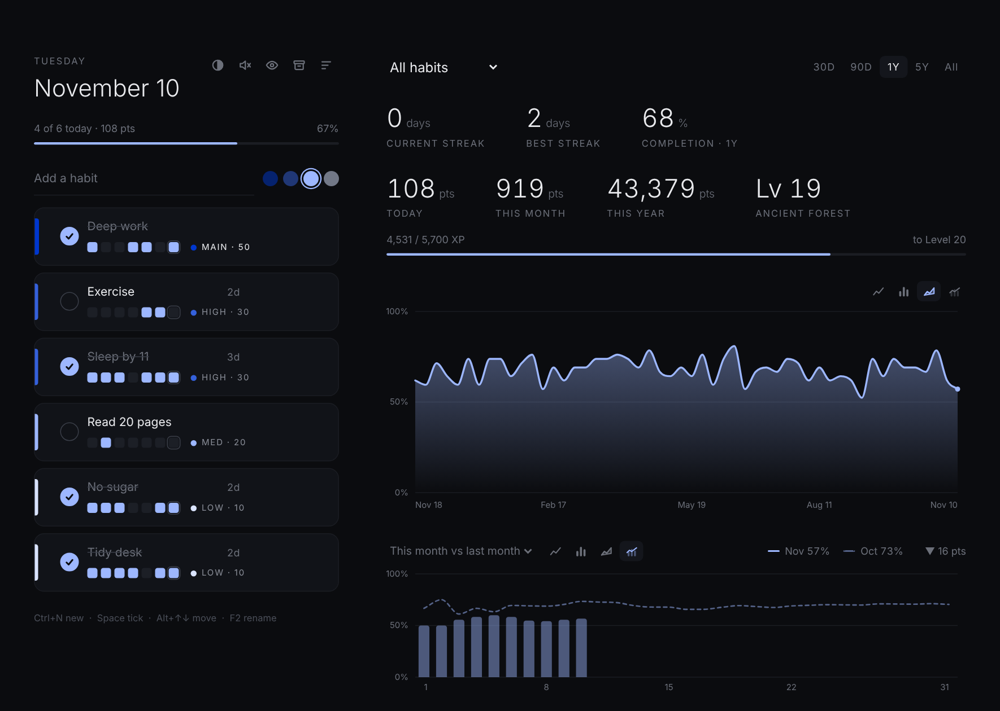
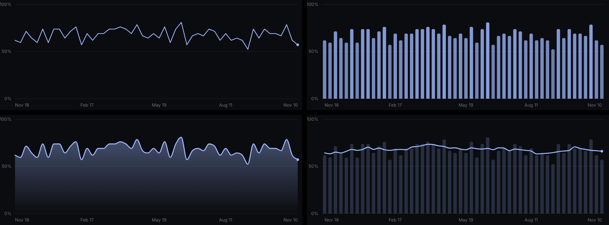

<div align="center">

# Habit Tracker

**A minimalist dark habit tracker for Windows.**
Cards, streaks, levels and four kinds of charts, all stored on your own PC.




</div>

## Why this one

- **Private.** No account, no cloud, no tracking. Your data is a single JSON file on your PC.
- **Honest.** A habit starts counting the day you create it and can't be backdated. Archived days are skipped, never counted as misses.
- **Motivating, not noisy.** Points, streaks and levels are there if you want them. The look stays black, white and one accent colour.

## Install

1. Download the newest installer from the [`releases/`](releases) folder and run it.
2. The installer is unsigned, so Windows SmartScreen will warn about an unknown publisher. Click **More info → Run anyway**.
3. Your data survives updates and uninstalling.

## Features

### Habits
- Each habit is a card. Add, rename (double-click or `F2`), reorder by dragging (or `Alt+↑/↓`), archive, or delete (with undo).
- **Priorities** show as shades of one accent colour: **Main** (only one at a time, 50 pts), **High** (30), **Medium** (20), **Low** (10). Past Main days keep their value after you move Main to another habit.
- **Sort menu**: priority, most done, least done, oldest, newest. Sorting is a one-time reorder (completion % since the habit started) and can be undone.
- Hide completed habits or show archived ones.

### Charts
Two graphs, and each one can be switched between four chart types:



| Type | Look |
| --- | --- |
| Line | Crisp line with an end marker |
| Column | Rounded columns, shaded by value like the heatmap |
| Area | Smooth curve over a soft gradient |
| Column + line | Faint columns with a smooth trend line on top |

- **Completion graph** with ranges 30D / 90D / 1Y / 5Y / All, for all habits or a single one.
- **Comparison graph**: this month vs last month, or this year vs last year.
- **Heatmap** with 5+ years of history.

### Score and levels
Finishing habits earns points, a streak multiplier (+10% per day, up to ×2) and a Perfect Day bonus (+25%). Points add up to levels, from Seed to Ancient Forest. Full rules: [docs/SCORING.md](docs/SCORING.md).

### Comfort
- Pick any accent colour, and every chart and shade follows it.
- Soft synthesized sound feedback (`Ctrl+M` to mute).
- Scales to any window size (auto zoom, `Ctrl +/−/0`, `F11` fullscreen).
- Atomic saves, a daily automatic backup (last 150 kept), and export/import.

## Keyboard shortcuts

| Key | Action |
| --- | --- |
| `Ctrl+N` | New habit |
| `Space` | Tick the selected habit |
| `Alt+↑` / `Alt+↓` | Move habit |
| `F2` | Rename |
| `Del` | Delete (undo available) |
| `Ctrl+M` | Mute / unmute sound |
| `Ctrl +` / `−` / `0` | Zoom in / out / reset |
| `F11` | Fullscreen |

## Your data

Everything lives in `%APPDATA%\Habit Tracker\`:

| File | Contents |
| --- | --- |
| `habits.json` | Your habits and history |
| `backups\` | One file per day, last 150 kept |
| `window.json` | Window size and zoom |

Nothing is ever sent anywhere. Format details: [docs/DATA.md](docs/DATA.md).

## Build from source

Requires [Node.js](https://nodejs.org) (18 or newer).

```bash
npm install
npm start      # run the app
npm test       # behaviour tests (jsdom, no window needed)
npm run dist   # build dist/HabitTracker-Setup-<version>.exe
```

Building the Windows installer on Linux needs `wine` (for icon embedding). electron-builder prints a harmless `Cannot read properties of null (reading 'channel')` after it has written the installer.

To publish a Windows installer, first update the `version` in `package.json` for the new release and include that change in the PR. **You must update this version for every new release**; the workflow does not increment it automatically. When a PR is merged into the repository's default branch, **Build and release** runs the tests, builds the installer, and attaches it to a GitHub Release tagged `v<version>` from `package.json`. You can also run the workflow manually from the repository's GitHub Actions tab.

## Project layout

```
src/main/       Electron main process: window, zoom, file storage, backups, IPC
src/renderer/   The UI (plain HTML/CSS/JS, no framework, no bundler)
  js/           Scripts loaded in order by index.html
build/          App icon (tools/make_icon.py regenerates it)
tests/run.js    Behaviour tests
releases/       Built Windows installers
docs/           ARCHITECTURE · SCORING · DATA · CHANGELOG
CLAUDE.md       Notes for AI assistants working in this repo
```

More detail: [docs/ARCHITECTURE.md](docs/ARCHITECTURE.md) · [docs/CHANGELOG.md](docs/CHANGELOG.md).

## Built with AI

This app was designed by [Qasim Tariq](https://github.com/qasim5920) and built together with Claude. `CLAUDE.md` holds the working notes so any assistant (or person) can pick the project up.

## License

[MIT](LICENSE) © 2026 Qasim Tariq
